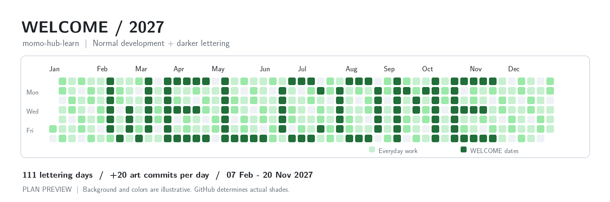

# WELCOME · 2027 贡献图计划

目标账号：[`momo-hub-learn`](https://github.com/momo-hub-learn)，显示名 **momo-hub**。

用户于 2026-10-12 选择：**正常开发照常进行，在字形日期增加图案提交，用深浅绿色突出 WELCOME。** 这是一项公开标注的 contribution art 计划；这些提交用于图案，不代表软件开发工作量或 AI坐标 的内容增量。

## 图案和时间表



- 7 行 × 53 列的全年日历；每列从星期日排到星期六。
- `WELCOME` 使用 5 × 7 字体，字母之间空一列，共占 41 列，左右各留 6 列。
- **111 个字形日**，每个字形日初始额外提交 **20 次**，全年计划 **2,220 次图案提交**。
- 其余 **254 天不额外绘图**，正常开发产生的贡献仍可显示。
- 字形的第一格是 **2027-02-07**，最后一格是 **2027-11-20**；控制范围为 2027 自然年。
- 布局以 **2027 自然年贡献视图**为准；主页默认的「过去一年」窗口会随时间移动，年内字形随日期逐步出现。
- 预览只说明布局和对比意图，不是实际贡献数据，也不保证 GitHub 将显示完全相同的颜色。

| 字母 | 所占周区间 | 字形日数 |
| --- | --- | ---: |
| W | 02-07 至 03-13 | 17 |
| E | 03-21 至 04-24 | 18 |
| L | 05-02 至 06-05 | 11 |
| C | 06-13 至 07-17 | 13 |
| O | 07-25 至 08-28 | 16 |
| M | 09-05 至 10-09 | 18 |
| E | 10-17 至 11-20 | 18 |

具体每日安排见 [dates.csv](dates.csv)，机器可读配置见 [plan.json](plan.json)。区间内不是每天都需要补图，以逐日表为准。

## 执行方式

工作流 [`WELCOME 2027 contribution art`](../../.github/workflows/welcome-2027.yml) 按北京时间 **19:17、20:47** 检查当天计划；第二次用于同日补跑。工作流由 GitHub 调度，实际启动可能延迟。实际写入只使用当天真实 UTC 时间，两个执行时段与北京时间处于同一日期。

执行器只写本目录的 `days/YYYY-MM-DD.json`。每一步生成一条明确标注 `contribution-art` 的提交，随后普通推送到 `main`。每日收据与提交历史用于防止重复补量。它校验仓库、分支、作者账号和文件变更范围；作者邮箱从已经归属于目标账号的固定历史提交读取，不需要新增个人令牌。

2026 年、2028 年及以后，以及非字形日，执行器返回无操作。它没有可以用于提前写入未来日期或补造历史日期的命令。真实项目的代码、数据来源时间、更新节奏和提交日期按正常开发流程处理。

本计划不控制其他设备、仓库、网页 PR、Issue 或评审操作。那些活动可以增加背景贡献。初始 20 次是可调整的工程参数，不是 GitHub 色阶阈值。若背景长期变深，应结合实际图像调整未来日期的补量，不改写既有开发历史。

## 查看与验证

从仓库根目录运行：

```bash
python contribution-art/2027/calendar_plan.py today
python contribution-art/2027/calendar_plan.py today --date 2027-02-07
python contribution-art/2027/runner.py
python -m unittest discover -s contribution-art/2027 -p 'test_*.py' -v
```

`calendar_plan.py` 只排日期；`runner.py` 默认只读。`--apply` 会创建当日的本地提交，额外指定 `--push` 才会推到 GitHub；实际执行要求已验证的仓库授权和作者归属。

## GitHub 规则与维护边界

GitHub 按作者日期、作者关联邮箱及分支等条件统计提交。正常仓库默认分支里的合格提交可以计入贡献；PR、Issue 等其他活动也可能计入。把旧提交延后推送并不能可靠地把贡献改记到推送日。参见 [Profile contributions reference](https://docs.github.com/en/account-and-profile/reference/profile-contributions-reference)。

GitHub 的颜色与其他日期的贡献数量有关，不存在本计划能保证的固定「20 次 = 最深绿」。参见 [ContributionCalendarDay](https://docs.github.com/en/graphql/reference/users#contributioncalendarday)。

定时工作流在默认分支运行，可能延迟或丢弃；公开仓库长时间无活动也可能停用定时任务。另设年度执行检查，用于发现漏跑、权限或归属变化。参见 [schedule 规则](https://docs.github.com/en/actions/reference/workflows-and-actions/events-that-trigger-workflows#schedule)。
